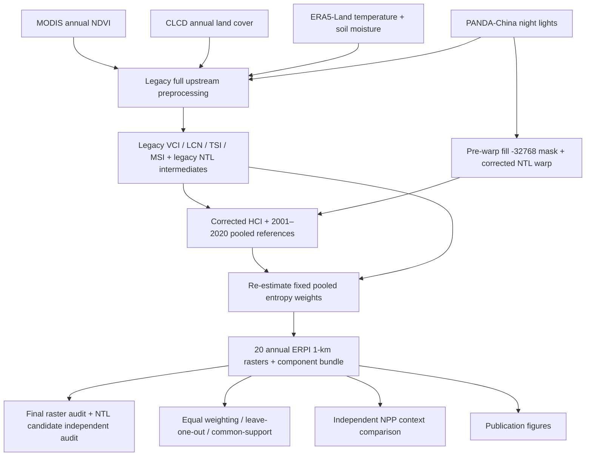

# ERPI workflow and dependencies

## Source processing
`generate_initial_legacy_product.py` contains `preprocess_ndvi`, `preprocess_clcd`, `preprocess_ntl`, `preprocess_multiband_annual`, `compute_baselines`, `build_indicators`, `compute_entropy_weights`, and `compute_eri`. Historical code does not mask the undeclared NTL fill before bilinear resampling.

## Correction
`generate_NTL_corrected_ERPI.py` uses source `-32768` masking before reprojection, recomputes NTL quantiles, all HCI layers, fixed entropy weights, and annual ERPI maps. It **reuses** the other four archived components and maintains or reduces original valid support.

## Validation
See `docs/CODE_PAPER_MAP.md` for per-result correspondence. Validate against final corrected rasters only; no data files are included here.
